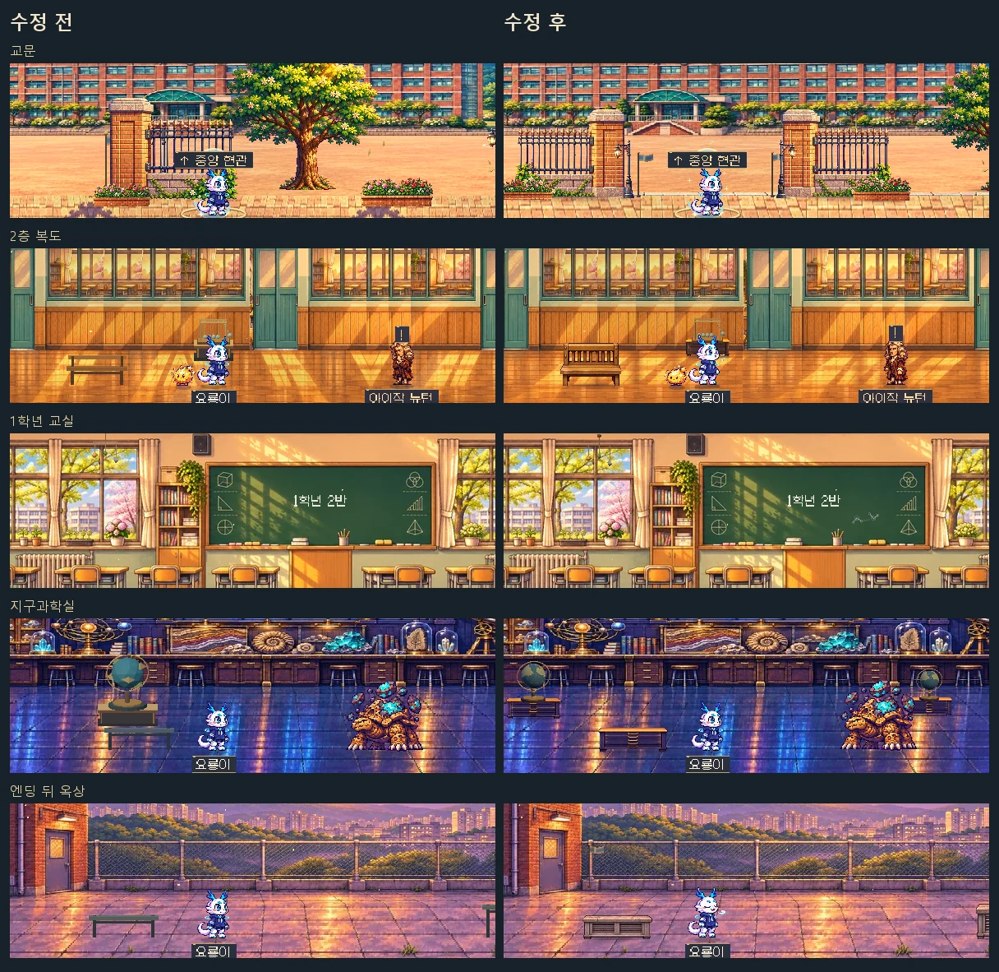

# 캠퍼스 구조물과 가구 원화

아래 그림은 같은 위치와 카메라에서 교문, 복도, 교실, 지구과학실, 엔딩 뒤 옥상을 촬영한 것입니다. 왼쪽은 이전 배포판, 오른쪽은 수정한 게임입니다.

## 원화와 게임 좌표

- [가구 원화](fixture-masters.webp)는 ImageGen으로 제작했습니다. 위쪽 줄에는 복도 벤치, 물리 실험대, 화학 서랍장이 있고 아래쪽 줄에는 생명과학 작업대, 지구과학 지도장, 옥상 환기구가 있습니다.
- [아틀라스 생성 스크립트](bake_fixtures.py)는 이 원화와 기존 계단 그림을 읽어 과목별 색상, 밤·아침의 옥상 표면, 바닥에 닿는 그림자와 실내 바닥 반사를 만듭니다. 저장소 최상위에서 Pillow와 NumPy가 설치된 Python으로 `python art/bake_fixtures.py`를 실행하면 `assets/world/fixtures.js`를 다시 생성합니다.
- [scenery.js](../scenery.js)에서 벤치의 좌판과 실험대의 윗면을 실제 점프 발판에 맞추고, 뒤쪽 전시대에 실험 장치를 놓습니다. [map3d.js](../map3d.js)는 이 위치에 Three.js 장치를 배치하고, [render.js](../render.js)는 같은 자리에 Canvas 2D 버전을 그립니다.
- 복도 벽과 마루는 같은 원화 구간에서 창문의 위치와 빛을 가져옵니다. 3~5층에서 교실 문이 열리면 해당 학년 교실의 원화가 보입니다.

가구 시트에 사용한 ImageGen 프롬프트

Stylized-concept production pixel-art furniture sprite sheet for a side-scrolling Korean school fantasy RPG. Transparent background, exactly SIX isolated objects arranged in a regular three-column by two-row grid. Each object separately centered in its cell, generous transparent gutters, entire silhouette and all feet visible. Near-frontal orthographic side-scroller view with only a narrow visible top surface (look down 13 degrees); every long top edge is straight and horizontal. Retro finely hand-clustered 16-bit pixel painting, crisp highlights on worn edges, stepped pixels, restrained woodgrain and metal rivets. Strong material texture. Small warm key light from upper left, deep colored outlines one pixel wide, no ground or cast shadow beyond feet. Top row left: a low honey-oak school hallway bench, slatted backrest, open gap, brass screws and four short wooden legs, profile width to height 2.6:1. Top middle: a physics workshop apparatus table in navy lacquered wood, antique brass edging, paneled doors and squat feet, absolutely clear flat top. Top right: a dark plum walnut apothecary workbench, small drawers with old copper pulls, clear marble top. Bottom left: a botanist's low moss-green potting bench, honey-oak top, green painted legs and slatted lower shelf, empty. Bottom middle: a dark indigo map cabinet for an astronomy classroom, flat golden oak top, slim shallow horizontal map drawers with brass handles. Bottom right: an old Korean school rooftop utility plinth, broad muted stone cap with a straight horizontal edge, weathered grey metal louvered front and inset vents, squat feet. All five tables/cabinets squat and broad, proportional width to height roughly 2.4 to 1. The flat tops must be unobstructed so a small game character can land on them. No objects on the tops. No captions, text, letters, numbers, framing, characters, terrain, scenery or grid lines.

